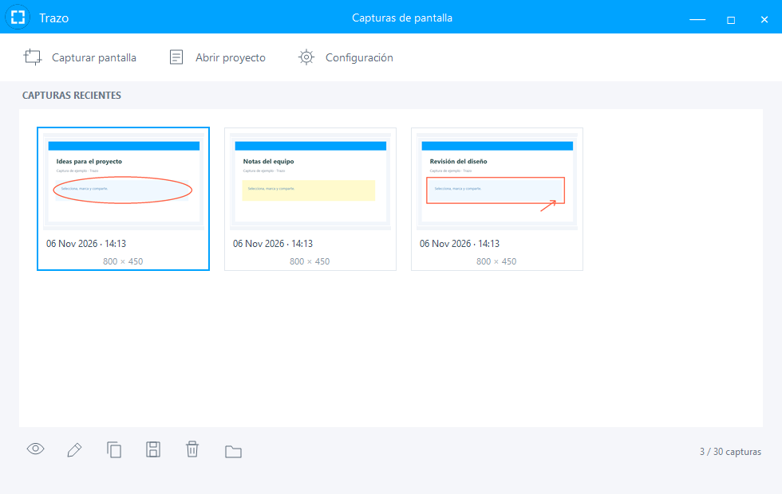
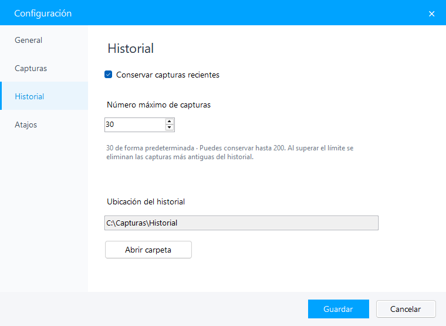

# Trazo

**Captura, anota y comparte.**

Una aplicación de código abierto para capturar áreas y ventanas en Windows, editar imágenes y organizar tus capturas recientes.

**[Descargar instalador para Windows](https://github.com/R4ckDev/trazo-app/releases/download/v0.4.1/Trazo-v0.4.1-setup.exe)** · [Versión portátil](https://github.com/R4ckDev/trazo-app/releases/download/v0.4.1/Trazo-v0.4.1-windows.zip) · [Ver releases](https://github.com/R4ckDev/trazo-app/releases/latest)

*Capturas de ejemplo en la ventana principal.*

## Qué puedes hacer

- **Capturar áreas o ventanas:** selecciona con un clic o arrastra un área; incluye varios monitores y lupa de precisión.
- **Leer QR y códigos de barras:** reconoce códigos en un área de pantalla o en una captura guardada y copia su contenido.
- **Elegir tamaño y proporción:** usa medidas exactas en píxeles, tamaños predefinidos o proporciones como 1:1, 4:3, 16:9 y 9:16, además de valores personalizados.
- **Organizar tus capturas:** una ventana principal con miniaturas, vista previa y acciones para copiar, editar, guardar o eliminar.
- **Ver los detalles:** redimensiona la ventana desde los bordes y esquinas. Un clic en una captura abre un visor ajustado a su tamaño real; si no cabe en la pantalla, se reduce manteniendo sus proporciones. Incluye ajuste a ventana, tamaño real y zoom.
- **Fijar referencias:** deja capturas encima de otras ventanas, muévelas, cambia su tamaño, copia la imagen original y ajusta la opacidad.
- **Conservar un historial:** guarda las últimas **30 capturas** por defecto. Puedes desactivarlo o ajustar el límite entre **1 y 200**.
- **Elegir tus atajos:** añade, cambia o quita las teclas y combinaciones que inician una captura.
- **Anotar a tu manera:** flechas, formas, pincel, texto, resaltado, pixelado y desenfoque, con colores y grosores ajustables.
- **Corregir y combinar:** mueve, redimensiona, duplica y ordena marcas por capas; pega imágenes y deshaz o rehace cambios.
- **Dar el acabado final:** giro, escala de grises, borde blanco y sombra, con vista previa antes de exportar.
- **Guardar y continuar:** copia al portapapeles, exporta PNG, JPEG o BMP y conserva proyectos editables `.trazo`.
- **Adaptar la aplicación:** configura el inicio con Windows, el comportamiento al cerrar, los atajos, el historial y la carpeta de guardado.

## Instalar y empezar

1. Descarga y ejecuta el **instalador de Trazo**. El asistente permite elegir la carpeta y los accesos directos.
2. Abre **Trazo** desde el menú Inicio o el escritorio.
3. Usa un atajo configurado o el botón **Capturar pantalla**. Haz clic sobre una ventana resaltada o arrastra para seleccionar un área.
4. Añade marcas con las barras flotantes y termina con **Ctrl + C** para copiar o **Ctrl + S** para guardar.

Las capturas terminadas aparecen en la ventana principal. Las canceladas no se añaden al historial. El límite conserva las más recientes y elimina automáticamente las copias antiguas del historial; tus archivos exportados se mantienen en la carpeta que elegiste.

El botón **···** del editor reúne las opciones de imágenes, capas, proyectos y efectos. Pulsa **V** para mover una marca o cambiar su tamaño; haz doble clic en un texto para corregirlo.

Durante la captura, pulsa **Tamaño y proporción** o **Ctrl + G** para elegir selección libre, ancho y alto exactos o una proporción fija. Las medidas corresponden a los píxeles capturados, sin ampliar la imagen; si no caben en el área disponible, Trazo te avisa. Puedes mover una selección de tamaño exacto y redimensionar una selección proporcional conservando su relación.

En el visor, **Ajustar** muestra la imagen completa y **100 %** permite inspeccionar los píxeles originales. Usa **+**, **−** o **Ctrl + rueda** para cambiar el zoom y las barras de desplazamiento para recorrer los detalles. **Esc** cierra la vista previa.

## Capturas flotantes

Después de seleccionar y anotar una captura, pulsa la chincheta **Fijar en pantalla** o **Ctrl + Mayús + P**. También encontrarás **Fijar en pantalla** al abrir una captura del historial.

La referencia queda encima de las demás ventanas. Arrastra la imagen para moverla y usa los bordes o las esquinas para cambiar su tamaño. Sus controles aparecen al pasar el ratón o enfocar la ventana: copiar, opacidad del 30 al 100 % y cerrar. **Ctrl + C** copia la imagen original y **Esc** cierra solo esa referencia. Cerrar una flotante no borra la captura del historial, si lo tienes activado. Al salir completamente de Trazo se cierran las referencias abiertas.

Las flotantes se ocultan mientras capturas o editas otra imagen para evitar que tapen el contenido, y se restauran al terminar.

## Leer QR y códigos de barras

Pulsa **Leer QR y barras** en la ventana principal, selecciona el código completo con sus márgenes y pulsa **Enter**. También puedes usar tu atajo habitual de captura y pulsar el botón azul **Leer QR y barras** después de seleccionar el área, o **Ctrl + Mayús + R**.

Al abrir una imagen del historial encontrarás el mismo botón en el visor. La lectura muestra el tipo y el contenido de los códigos encontrados; puedes seleccionar uno, copiar su contenido o copiar todos. Si contiene un enlace HTTP o HTTPS, **Abrir enlace** lo abre únicamente cuando lo pulsas.

La lectura se realiza localmente, sin enviar la imagen a servicios externos. Incluye QR, Code 128, EAN-13, EAN-8, UPC, Code 39, Code 93, ITF, Codabar, Data Matrix, Aztec y PDF417. Los códigos muy pequeños, borrosos o recortados pueden requerir acercar la imagen o seleccionar una zona más precisa, conservando el margen del código. Leer o cancelar la lectura no añade capturas al historial.

La versión aparece en la cabecera de la ventana principal. Si una versión anterior sigue ejecutándose, ciérrala completamente desde la bandeja antes de abrir la nueva.

## Configuración

Abre **Configuración** en la ventana principal o desde el icono junto al reloj:

- **General:** iniciar con Windows y elegir qué ocurre al cerrar la ventana.
- **Capturas:** carpeta, formato de imagen y visibilidad del panel principal durante la selección.
- **Historial:** activar el guardado y elegir cuántas capturas conservar, hasta 200.
- **Atajos:** gestionar las teclas y combinaciones de captura.

La primera vez que cierras la ventana puedes elegir **quedar en la bandeja**, **cerrar Trazo** o **cancelar**, y recordar la elección. Para salir completamente desde la bandeja, elige **Cerrar Trazo**.

## Atajos del editor

| Atajo | Acción |
| --- | --- |
| **V** | Seleccionar y editar una marca |
| **Ctrl + Z / Ctrl + Y** | Deshacer / rehacer |
| **Ctrl + D / Supr** | Duplicar / eliminar una marca |
| **Ctrl + C / Ctrl + S** | Copiar captura / guardar imagen |
| **Ctrl + Mayús + S** | Guardar proyecto editable |
| **Ctrl + Mayús + P** | Fijar captura en pantalla |
| **Ctrl + Mayús + R** | Leer QR y códigos de barras |
| **Esc** | Quitar selección o cancelar |

Mientras escribes texto, **Enter** confirma la anotación y **Mayús + Enter** añade un salto de línea. Los proyectos `.trazo` conservan el fondo y las marcas; para compartir el resultado final, exporta una imagen.

## Requisitos y desinstalación

- Windows con **.NET Framework 4.8**.
- El instalador es para tu usuario y no necesita permisos de administrador.
- También puedes usar el ZIP portátil sin instalar.
- Puedes desinstalar Trazo desde **Configuración de Windows → Aplicaciones**. Las capturas y preferencias personales se conservan.

## Participa

¿Encontraste un fallo o tienes una idea? [Abre un issue](https://github.com/R4ckDev/trazo-app/issues). Para contribuir al código, consulta [CONTRIBUTING.md](CONTRIBUTING.md).

## Licencia

[MIT](LICENSE) · Copyright © 2026 R4ckDev.

El lector utiliza [ZXing.Net](https://github.com/micjahn/ZXing.Net), distribuido bajo Apache-2.0. Su licencia y procedencia se incluyen con la aplicación.
